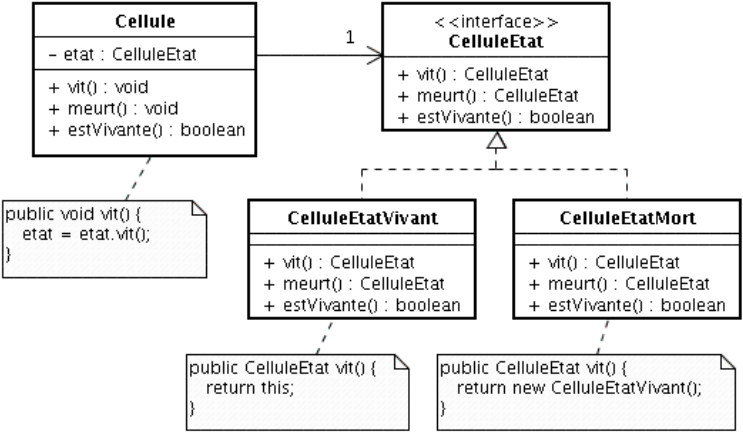
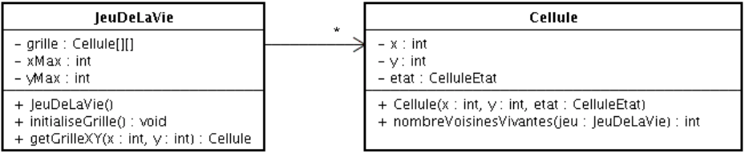
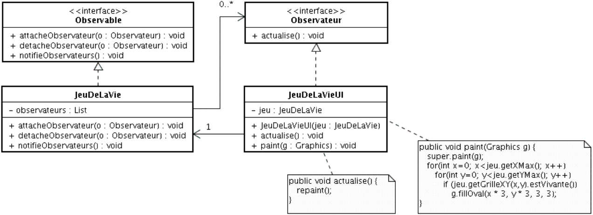
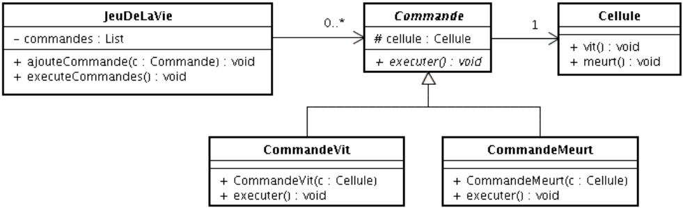
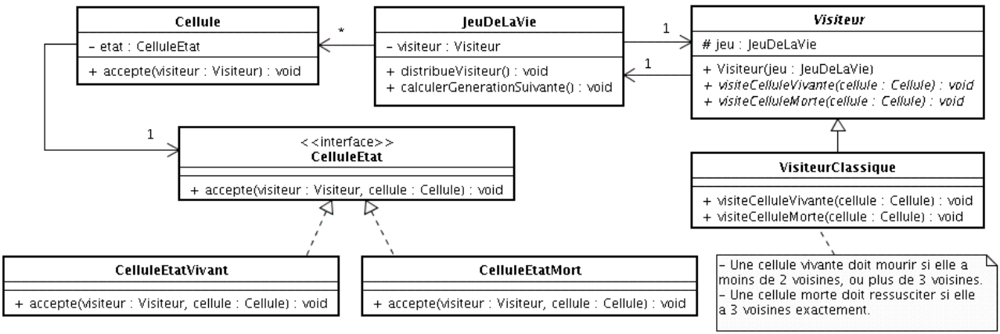

# Jeu de la vie
Dans le cadre du TP3 de Design Pattern nous allons créer un automate cellulaire appellé Jeu de la vie.

## Qu'est-ce qu'un automate cellulaire ?

Un automate cellulaire est un objet mathématique qui permet de simuler l'évolution d'une population de cellules virtuelles au cours de temps, selon des règles de voisinage. Ces règles sont appliquées à toutes les cellules d'une même génération, produisant ainsi une nouvelle génération, entirèrement dépendante de la génération précédente. Le "Jeu de la Vie" du mathématicien John Conway est un exemple d'automate cellulaire à deux dimensions dont les règles d'évolution sont les suivantes :
 - Si une cellule possède moins de deux voisines, elle va mourir (solitude);
 - Si une cellule possède plus de trois voisines elle va mourir (etouffement);
 - Si un emplacement vide possède trois voisines, une nouvelle cellule va naître;

Nous sommes ordonnés d'implémenter le Jeu de la Vie selon un modèle fondé sur cinq Design Pattern :

- Etat
- Singleton
- Observateur
- Commande
- Visiteur

En séparant structures de données, règles de fonctionnement et interface graphique, la modélisation fondée sur les patrons de conception simplifie considérablement la maintenance du logiciel.

# 1. Implémentation des cellules et leurs états
Premièrement nous allons implémentre la structure de données de Jeu de la Vie à l'aide d'un tableau de cellules, chaque cellule étant caractérisée par son état (vivante ou morte)? Le modèle de référennce est la version minimale du DP Etat. Son instanciation pour le Jeu de la Vie est sur le diagramme d'états ci-dessous. La modification de l'état d'une cellule se fait par invocation des méthodes _vit_ et _meurt_ de la cellule.



Ce modèle représente un inconvénient: celui de multiplier inutilement les instance des classes réprésentant les états vivant et mort des cellules. En effet, les classes ***CelluleEtatVivant***  ***CelluleEtatMort*** n'ont pas de variables d'instances. Leur état (au sens POO) ne peut pas être modifié. Il est donc inutle de disposer de plusieurs instances de ces classes. Vous allez y remédier en implementant le DP Singleton.

# 2. Implémentation de la grille de cellules

Le modèle des cellules étant implémenter, nous pouvons implémenter la grille de cellules, comme attribut de la class ***JeuDeLaVie***. Nous allons completer le programme selon le modèle donné ci-dessous. La méthode _initialiseGrille_ doit peupler le tableau avec des cellules vivantes ou mortes, en fonction de la méthode _rnd.nextBoolean()_ qui retourne un bouléen ( 0 ou 1). La méthode _nbVoisinsVivants_ de la classe ***Cellule*** retourne le nombre de cellules vivantes se trouvant dans le voisinnage de la cellule (8 emplacements à tester pour les cellules qui ne sont pas au bord).



# 3. Implémentation de l'interface graphique

L'intefarce graphique du jeu sera modéilisée selon le DP "Observateur". Dans notre cas, l'observable est une ***JeuDeLaVie***, et l'obeservateur est un ***JeuDeLaVieUI***. Nous allors implémenter le mobèle ci-dessous, puis nous allons écrire la méthode _main_ de ***JeuDeLaVie*** qui va instancer un ***JeuDeLaVie***, un ***JeuDeLaVieUI***, et qui va enregistrer ce dernier comme observateur. A la fin de cette étape, vous pourrez visualiser la population initiale aléatoire de cellules.




# 4.Implémentation des actions sur les cellules

Dans l'implémentation "classique" du jeu de la vie, la génération suivates est construite dans un deuxième tableau, afin de ne pas modifier la génération courante. Une fois terminée, la génération suivante (qui devient la génération courante) est intégralement recopiée dans le premier tableau. Une autre solution consiste, dans un premier temps, à stocker dans une file d'attentes toutes les actions à effectuer (modifications des cellules), puis dans un deuxième temps à executer toutes les actions. Cette solution n'utilise pas de second tableau, ni d'étapes de recopie. Elle repose sur l'utilisation du DP "Commande".

Dans ce DP, un "client" instancie des commandes destinées à un receveur, et un invoqueur déclenche l'execution des commandes. Dans l'image ci-dessous l'invocateur est un ***JeuDeLaVie***, les receveurs sont des cellules, et les actions sont _vit_ et _meurt_ (le client sera défini au cours de l'étape n°5). La méthode _executeCommandes_ éxécute toutes les commandes et vide la liste.



# 5. Implémentation des règles du jeu

La cinquième étape consiste à écrire les règles du jeu en utilisant le DP "Visiteur". Un visiteur est une façon de séparer un algorithme d'une structure de données. Le client distribue un visiteur aux éléments, qui demandent à leur visiteur d'exécuter le traitement. Dans le diagramme ci-dessous, le client est le ***JeuDeLaVie***, les éléments sont des cellules, le visiteur est ***VisiteurClassique***. La métode  _distribueVisiteur_ invoque la méthode _accepte_ de toutes les cellules, lesquelles invoquent la méthode accepe de leur état(délégation). Enfin, ce dernier invoque la méthode du visiteur (visiteCelluleVivante ou visiteCelluleMorte), laquelle va instancier et ajouter une nouvelle commande (CommandeVit ou CommandeMeurt selon l'environment de la cellule) dans la fille d'attente de commandes du jeu.



# 6. Extensions et améliorations

Pour cette sixième étape nous devons créer au moins faire :
- Un deuxième visiteur qui se contente d'afficher dans la console Java le numéro de la génération courante et le nombre de cellules actuellement en vie.
- Ajouter des visiteur qui implémentent des règles alternatives comme HighLife, Day & Night, etc.
- Ecrire une interface graphique qui comporte un certain nombre de commandes :
    - Bouton pour exécuter/arrêter la boucle d'éxecution;
    - Bouton pour avancer d'une génération lorsque la boucle est arrêter;
    - Slider pour ajouter la vitesse de la boucle d'exécution;
    - Contrôle de sectuibs des règles du jeu, etc.

Pour commencer j'ai ajouter le DP "Etat" afin de gérer un menu de présentation, ainsi que des paramètres et le jeu en lui même, ce qui nous permettra plus tard d'ajouter des boutons pour contrôler les rêgles du jeu. J'ai aussi ajouter le fait que nous pouvons configurer les cellules lorsqu'elles sont en pause, ce qui permet donc de faire une configuration de départ, ou permet de la modifier " à la volée". J'ai aussi ajouter un système de zoom sur la grille, la taille de la grille personnalisable, ce qui remettra à 0 la grille si elle est déjà initialisé. Je controlerai aussi la taille des cellules.

Pour se faire j'ai implémenter le pattern Singleton aux visiteurs, car nous n'avons aucunement besoin de plusieurs instance.

# 7. Refactoring OOP — Remplacement des Singletons paramétrés par une Factory

## Pourquoi le Singleton paramétré est un anti-pattern

Les visiteurs de règles (`VisiteurClassique`, `VisiteurHighLife`, `VisiteurDayNight`) étaient
initialement implémentés comme des Singletons avec une signature `getInstance(JeuDeLaVie jeu)`.
Cette combinaison constitue un anti-pattern pour plusieurs raisons :


**1. Le Singleton est injustifié ici**

Le Singleton se justifie quand une classe n'a *vraiment* pas d'état propre (ex. : `CelluleEtatVivant`,
`CelluleEtatMort` qui sont des marqueurs purs). Les visiteurs de règles, eux, reçoivent un
`JeuDeLaVie` en dépendance — ils ont un état contextuel. Partager une instance unique avec un état
partagé introduit un couplage inutile.

**2. Les tests deviennent fragiles**

Avec un Singleton, les tests partagent l'instance entre méthodes. L'ordre d'exécution devient
important, les mocks peuvent "fuir" d'un test à l'autre, et `@BeforeAll` masque le problème
sans le résoudre.

## Solution : Factory Method

Un `VisiteurFactory` centralise la création des visiteurs :

```java
public class VisiteurFactory {
    public static Visiteur creer(TypeVisiteur type, JeuDeLaVie jeu) {
        switch (type) {
            case HIGH_LIFE:  return new VisiteurHighLife(jeu);
            case DAY_NIGHT:  return new VisiteurDayNight(jeu);
            default:         return new VisiteurClassique(jeu);
        }
    }
}
```

**Avantages :**
- Chaque appel retourne une instance fraîche liée au bon `JeuDeLaVie` → pas d'effet de bord
- Point d'extension unique : ajouter un visiteur ne touche que la factory et l'enum `TypeVisiteur`
- Tests isolés : chaque test crée sa propre instance via `new VisiteurXxx(mockJeu)`

## Autres améliorations apportées

| Pattern | Avant | Après |
|---|---|---|
| **Strategy** | Implicite (classe abstraite `Visiteur`) | Interface `RegleJeu` explicite — le contrat est nommé |
| **Decorator** | `VisiteurTerminal` appliqué en boucle séparée | `VisiteurTerminal` enveloppe la règle active et lui délègue |
| **Adapter** | Classes nommées `ISouris`, `IClavier` (préfixe trompeur) | `AdaptateurSouris`, `AdaptateurClavier` — rôle évident |
| **Visibilité mémoire** | `Constants.pause`, `EtatJeu.etatActuel` non-`volatile` | `volatile` ajouté pour garantir la visibilité entre threads |
